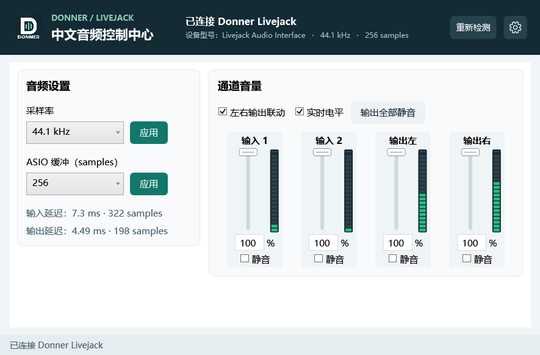

# Donner Livejack 中文控制面板

> 我手头只有 Livejack 2x2 这一个型号，所有测试均基于这台设备。

作者：[topsai (范斯特洛夫斯基)](https://github.com/topsai) · 项目：[GitHub](https://github.com/topsai/donner-livejack-control-panel) · [下载最新版本](https://github.com/topsai/donner-livejack-control-panel/releases/latest) · [反馈问题](https://github.com/topsai/donner-livejack-control-panel/issues)

适用于 Donner Livejack 的非官方 Windows 桌面控制面板。使用原厂驱动与控制 API，提供紧凑的中文界面，不替换声卡驱动。



## 下载与安装

推荐在 [Releases](https://github.com/topsai/donner-livejack-control-panel/releases/latest) 下载 `DonnerControlPanel-v1.21-Setup-win-x64.exe`，双击安装。安装包自带 .NET 运行时和原厂 USB 音频驱动，无需联网或另外下载驱动。

- 已有兼容的原厂驱动：自动跳过驱动安装。
- 缺少兼容驱动：先打开内置的原厂驱动安装向导。允许 Windows 管理员授权并完成向导后，安装程序会检查驱动，再安装中文面板。
- 驱动安装取消或未成功：提示重试，不会报告安装完成。若原厂向导要求重启，重启后再次运行本安装包。
- 中文面板默认安装到 `%LOCALAPPDATA%\Programs\DonnerControlPanel`，创建开始菜单和桌面快捷方式；可从 Windows 设置卸载。卸载中文面板保留原厂驱动及个人配置。

也提供便携 ZIP：解压后双击 `DonnerControlPanel.exe`，保留整个目录。便携版不含驱动，需要电脑已经安装兼容驱动。

当前验证的设备为 USB `VID_152A / PID_885C`，系统名称为 `Livejack Audio Interface`。当前支持的控制 API 为 5.0.0.0 / ABI 5.7，程序会校验 DLL 哈希；其他型号或版本暂未验证。

## 功能

- 输入 1/2、输出左/右竖向分段电平柱，通过 Windows 音频输入和输出回环读取，可关闭。
- 采样率与 ASIO 缓冲调节，显示驱动报告的输入、输出延迟和设备名称。
- 两路输入、左右输出音量及静音，左右输出联动，全输出静音/取消静音切换。
- 拖动滑块、直接输入百分比或用方向键按 1% 选档；实际音量受硬件步进限制，相邻档位可能对应相同音量。
- USB 拔插后自动重连，丢弃旧设备状态并重新读取当前设置。
- 预设保存与应用、诊断日志、最小化至托盘、可关闭的 Windows 登录自启动。
- 原厂驱动设置：输出 16/24 位、ASIO 安全模式、按需/持续音频流、时钟锁定及 WDM/ASIO 占用状态。修改缓冲会保留安全模式；未支持或未读到的项隐藏。
- 面板说明：点击照片中的 01–13 编号，查看对应接口、旋钮与开关的中文说明。

默认窗口为 900 × 620。音频设置与通道音量左右排列；其他页面从右上角齿轮菜单进入。

启动和重连只读取设置，不自动应用预设。没有获得设备支持或未成功读取的功能不会显示。当前不包含 EQ、降噪、回环、固件升级或硬件按钮远程控制。

## 使用细节

- F5：重新检测；Ctrl+S：保存预设；Ctrl+M：切换输出静音。
- 点击关闭按钮退出；最小化后双击托盘图标恢复。
- 配置与日志位于 `%LOCALAPPDATA%\DonnerControlPanel`。
- 开机启动仅对当前 Windows 用户生效，登录后在托盘运行。移动程序目录后，打开程序可更新已启用的启动项路径。
- 应用预设会校验设备与能力；写入后读取设备实际返回状态。调节音量不会自动取消静音。

## 从源码构建

需要 Windows 10/11 x64、[.NET SDK 10.0.401](https://dotnet.microsoft.com/download/dotnet/10.0) 或兼容补丁版本。

```powershell
.\build.ps1
```

输出位于 `dist\DonnerControlPanel`。脚本先运行测试，再发布前端和辅助进程。

生成包含驱动的安装包，需要 [Inno Setup 6.7.3](https://github.com/jrsoftware/issrc/releases/tag/is-6_7_3) 和原下载包中的、未经修改且带有效数字签名的 `Donner_UsbAudio_v5.0.0_2021-03-29_setup.exe`：

```powershell
.\build-installer.ps1 -DriverInstaller 'C:\drivers\Donner_UsbAudio_v5.0.0_2021-03-29_setup.exe'
```

脚本验证原厂签名与 SHA-256，输出 `dist\DonnerControlPanel-v1.21-Setup-win-x64.exe`。源码仓库不保存驱动二进制。安装包内驱动为原厂 5.0.0 版本（SHA-256：`12EF3F0F517B2F00A7EBBA3DBC0CAC978E4A71ECE8599B31FFE853304DD147F0`），保持原文件；安装过程交由原厂向导执行。

安装脚本的简体中文语言文件来自 [Inno Setup 仓库](https://github.com/jrsoftware/issrc/blob/main/Files/Languages/ChineseSimplified.isl)，保留作者署名。

单独运行核心测试：

```powershell
dotnet run --project tests/Donner.Tests -c Release
```

界面冒烟检查：

```powershell
.\dist\DonnerControlPanel\DonnerControlPanel.exe --smoke build\smoke
```

冒烟检查采用独立数据目录；真实设备仅查询，设置操作在内部模拟数据中验证。生成页面图片与 `smoke-result.json` 后退出。

## 项目结构

| 目录 | 用途 |
|---|---|
| `src/Donner.Core` | 能力检查、音量映射、预设、设备状态与进程通信 |
| `src/Donner.Host` | 隔离进程调用原厂控制 API，检测设备并读写设置 |
| `src/Donner.Panel` | WPF 中文界面、托盘、自动启动与面板说明 |
| `tests/Donner.Tests` | 63 项核心回归检查，无第三方测试框架 |

源码仓库与便携 ZIP 不包含原厂驱动；统一安装 EXE 包含未经修改的原厂驱动安装程序。品牌名称用于说明兼容设备；此项目非 Donner 官方产品。

驱动功能和实时电平说明见 [功能说明](docs/driver-features.md)。
