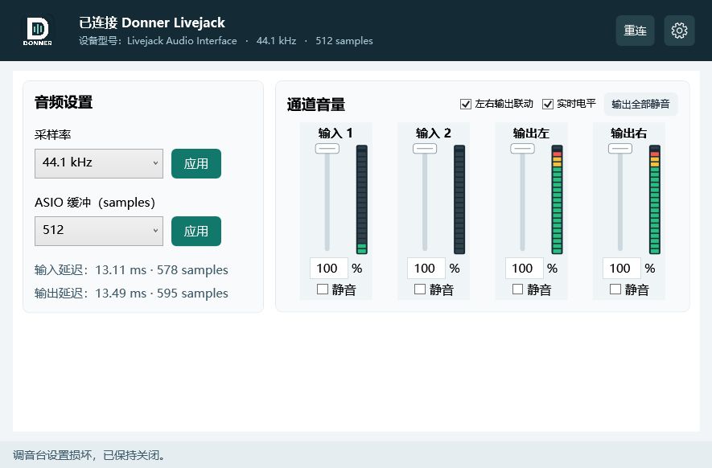
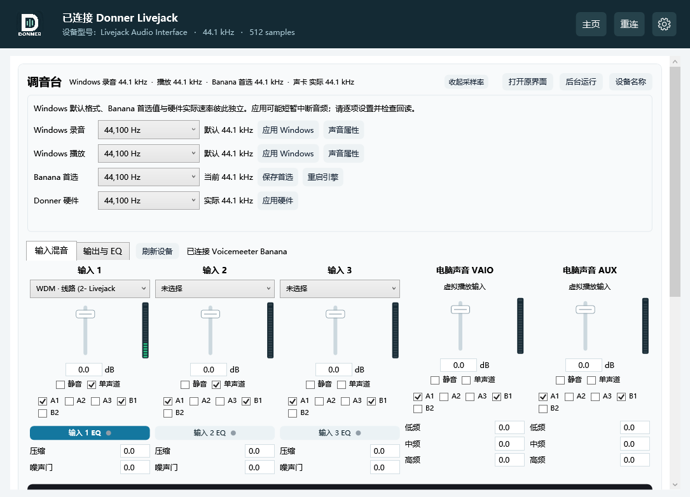
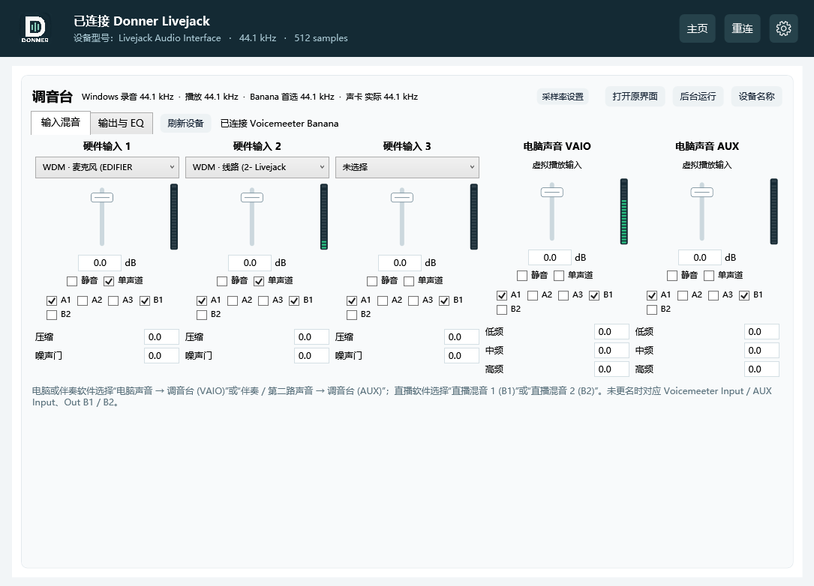
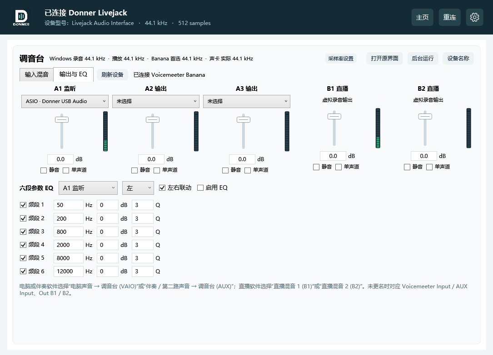

# Donner Livejack 中文控制面板

> 我手头只有 Livejack 2x2 这一个型号，所有测试均基于这台设备。

作者：[topsai (范斯特洛夫斯基)](https://github.com/topsai) · 项目：[GitHub](https://github.com/topsai/donner-livejack-control-panel) · [下载最新版本](https://github.com/topsai/donner-livejack-control-panel/releases/latest) · [反馈问题](https://github.com/topsai/donner-livejack-control-panel/issues)

适用于 Donner Livejack 的非官方 Windows 桌面控制面板。使用原厂驱动与控制 API，提供紧凑的中文界面，不替换声卡驱动。



## 可选调音台

应用设置中的“启用调音台功能”默认关闭，安装包不附带 Banana。勾选后检测 Voicemeeter Banana，未安装时进入官方安装引导；取消引导不启用。

> 本功能面向不熟悉 Banana 等专业调音软件的用户。如果您已经安装并熟练使用 Banana，建议不要勾选；在本面板选择设备、调整路由或音效，可能改动您原有的 Banana 配置。连接时不会重置参数，但之后的操作会直接作用于 Banana。

启用后，顶部“重连”前方出现“调音台”按钮，点击进入独立调音台页面，按钮变为“主页”，再次点击返回。主页保留 v1.22 的声卡控制布局；输入混音、路由、输出和 EQ 均放在调音台页面。取消勾选后隐藏入口，若正在调音台页面则返回主页。详见 [调音台使用与验证范围](docs/mixer.md)。


### 后台使用与设备名称（v1.25）

启用调音台后，Donner 面板自动连接或在后台启动 Banana，并隐藏原界面；只使用本面板即可调节现有混音功能。Banana 音频引擎仍须运行。调音台中的“打开原界面”用于需要高级设置时主动显示它，“后台运行”重新隐藏原界面。引擎退出后，启用期间会尝试后台重启；取消勾选则停止自动启动，不会强制结束仍在使用的混音引擎。

齿轮 → 应用设置 → **设备名称与用途** 可查看对应关系，并按需点击“简化 Windows 设备名称”或“恢复更名前名称”。更名需要 Windows 管理员授权。更名前保存备份，恢复时跳过后来手动设置的名称；不修改设备 ID、默认音频设备或混音路由，也不禁用任何设备。Windows 与使用这些设备名称的直播软件可显示中文；已经打开的软件可能需要重新启动，ASIO/KS 等直接使用驱动名称的界面可能仍显示原名。

| Windows 中的用途 | 中文名称 | 原厂名称 |
|---|---|---|
| 播放设备：电脑声音送入调音台 | 电脑声音 → 调音台 (VAIO) | Voicemeeter Input |
| 播放设备：伴奏等第二路声音送入调音台 | 伴奏 / 第二路声音 → 调音台 (AUX) | Voicemeeter AUX Input |
| 录音设备：直播软件读取第一路混音 | 直播混音 1 (B1) | Voicemeeter Out B1 / Output |
| 录音设备：直播软件读取第二路混音 | 直播混音 2 (B2) | Voicemeeter Out B2 / AUX Output |

A1–A3 的录音端点标为“监听总线录音”；额外播放通道标为“扩展播放通道”。VAIO3、A4、A5、B3 标明 Potato 扩展，不将它们当作 Banana 可用条带。这些额外设备来自原厂驱动，本项目不会自动删除。

更名备份位于 `%LOCALAPPDATA%\DonnerControlPanel\mixer-endpoint-names.json`，请保留，以便恢复。更新或重装 Banana 驱动可能重建设备，需要重新核对名称。

### 采样率、自定义名称与主页电平

调音台顶部直接显示 Windows 录音、Windows 播放、Banana 首选和 Donner 实际采样率。点击标题旁的“采样率设置”可展开编辑区并逐项修改：

- Windows 两项：修改 Livejack 录音/播放端点的默认格式，需要管理员授权，成功时检查 Windows 音频引擎的回读。
- Banana 首选：点击“保存首选”，再按需点击“重启引擎”；首选值与声卡实际工作速率分开展示。
- Donner 硬件：通过原厂 API 设置，使用驱动报告的支持列表，显示实际回读。被其他音频程序占用或未生效时报告失败。

这些值不一定必须相同，但在本机卡拉 OK 连接方式下建议保持一致。改动可能短暂中断声音；采样率区加载和刷新只读取，不自动提交选择值。

点击调音台右上角“设备名称”（或齿轮 → 应用设置 → 设备名称与用途），可编辑当前物理和虚拟播放/录音设备的名称，再点击“保存自定义名称”。名称同时用于 Windows 和本面板，保留设备 ID，原名备份可恢复。其他软件若仍使用旧名称，需要重新选择设备或重启刷新。

Banana 接管 Livejack 输出时，主页从实际对应的 A1/A2/A3 总线读取左右声道电平，避免独占输出使 Windows 回环采集失效。不会将其他声卡的总线或某一通道的最大值冒充左右输出。未能唯一对应总线时不显示错误的替代读数；关闭调音台后恢复原来的 Windows 采集方式。电平不包含声卡的模拟直通监听。

v1.28 将采样率摘要和设置入口移到“调音台”标题旁，收起时不再占用单独区域。Windows 格式与设备识别查询、设备名称窗口的枚举与保存、电平采集的打开/重试/释放改在后台执行；同类查询不重叠，隐藏页面暂停不必要的刷新。设备写入和预设操作会等待此前的采集资源清理完毕。

本机一次实测：Windows 查询耗时约 1.88 秒期间，界面调度最大间隔约 32 毫秒；[验证记录](docs/verification/v1.28-responsiveness.json)。



调音台推子的 **-60 至 +12 dB** 是 Banana 的增益范围：0 dB 不增不减，负值衰减，正值放大。v1.29 起拖动靠近零点会吸附；**双击推子或点击下方分贝数值可精确归零**，方向键保持 0.1 dB 微调。归零只修改该通道的增益，不切换静音和路由。

### v1.29 调音台截图

以下截图来自已连接的 Banana，仅只读采集界面，未修改现有配置。

输入混音：



输出与 EQ：



## 下载与安装

推荐在 [Releases](https://github.com/topsai/donner-livejack-control-panel/releases/latest) 下载 `DonnerControlPanel-v1.29-Setup-win-x64.exe`，双击安装。安装包自带 .NET 运行时和原厂 USB 音频驱动，无需联网或另外下载驱动。

- 已有兼容的原厂驱动：自动跳过驱动安装。
- 缺少兼容驱动：先打开内置的原厂驱动安装向导。允许 Windows 管理员授权并完成向导后，安装程序会检查驱动，再安装中文面板。
- 驱动安装取消或未成功：提示重试，不会报告安装完成。若原厂向导要求重启，重启后再次运行本安装包。
- 中文面板默认安装到 `%LOCALAPPDATA%\Programs\DonnerControlPanel`，创建开始菜单和桌面快捷方式；可从 Windows 设置卸载。卸载中文面板保留原厂驱动及个人配置。

也提供便携 ZIP：解压后双击 `DonnerControlPanel.exe`，保留整个目录。便携版不含驱动，需要电脑已经安装兼容驱动。

当前验证的设备为 USB `VID_152A / PID_885C`，系统名称为 `Livejack Audio Interface`。当前支持的控制 API 为 5.0.0.0 / ABI 5.7，程序会校验 DLL 哈希；其他型号或版本暂未验证。

## 功能

- 输入 1/2、输出左/右竖向分段电平柱，通过 Windows 音频输入和输出回环读取，可关闭。
- 采样率与 ASIO 缓冲调节，显示驱动报告的输入、输出延迟和设备名称。
- 两路输入、左右输出音量及静音，左右输出联动，全输出静音/取消静音切换。
- 拖动滑块、直接输入百分比或用方向键按 1% 选档；实际音量受硬件步进限制，相邻档位可能对应相同音量。
- USB 拔插后自动重连，丢弃旧设备状态并重新读取当前设置。
- 预设保存与应用、诊断日志、最小化至托盘、可关闭的 Windows 登录自启动。
- 原厂驱动设置：输出 16/24 位、ASIO 安全模式、按需/持续音频流、时钟锁定及 WDM/ASIO 占用状态。修改缓冲会保留安全模式；未支持或未读到的项隐藏。
- 面板说明：点击照片中的 01–13 编号，查看对应接口、旋钮与开关的中文说明。

默认窗口为 900 × 620。音频设置与通道音量左右排列；其他页面从右上角齿轮菜单进入。

启动和重连只读取设置，不自动应用预设。没有获得设备支持或未成功读取的功能不会显示。原厂设备控制不提供硬件 EQ、降噪、回环、固件升级或硬件按钮远程控制；软件混音与 EQ 可通过可选调音台实现。

## 使用细节

启动后自动检查 GitHub 正式发布版，每 6 小时再次检查，也可在“关于”中手动检查。有新版本时，设置齿轮和“关于”菜单项旁显示红点，“关于”提供更新说明和版本下载页；当前版本不低于发布版时不显示红点。检查失败会说明原因，不会当作已是最新版；重新检查失败时保留先前已确认的新版本提醒。

- F5：重连；Ctrl+S：保存预设；Ctrl+M：切换输出静音。
- 点击关闭按钮退出；最小化后双击托盘图标恢复。
- 配置与日志位于 `%LOCALAPPDATA%\DonnerControlPanel`。
- 开机启动仅对当前 Windows 用户生效，登录后在托盘运行。移动程序目录后，打开程序可更新已启用的启动项路径。
- 应用预设会校验设备与能力；写入后读取设备实际返回状态。调节音量不会自动取消静音。

## 从源码构建

需要 Windows 10/11 x64、[.NET SDK 10.0.401](https://dotnet.microsoft.com/download/dotnet/10.0) 或兼容补丁版本。

```powershell
.\build.ps1
```

输出位于 `dist\DonnerControlPanel`。脚本先运行测试，再发布前端和辅助进程。

生成包含驱动的安装包，需要 [Inno Setup 6.7.3](https://github.com/jrsoftware/issrc/releases/tag/is-6_7_3) 和原下载包中的、未经修改且带有效数字签名的 `Donner_UsbAudio_v5.0.0_2021-03-29_setup.exe`：

```powershell
.\build-installer.ps1 -DriverInstaller 'C:\drivers\Donner_UsbAudio_v5.0.0_2021-03-29_setup.exe'
```

脚本验证原厂签名与 SHA-256，输出 `dist\DonnerControlPanel-v1.29-Setup-win-x64.exe`。源码仓库不保存驱动二进制。安装包内驱动为原厂 5.0.0 版本（SHA-256：`12EF3F0F517B2F00A7EBBA3DBC0CAC978E4A71ECE8599B31FFE853304DD147F0`），保持原文件；安装过程交由原厂向导执行。

安装脚本的简体中文语言文件来自 [Inno Setup 仓库](https://github.com/jrsoftware/issrc/blob/main/Files/Languages/ChineseSimplified.isl)，保留作者署名。

单独运行核心测试：

```powershell
dotnet run --project tests/Donner.Tests -c Release
```

界面冒烟检查：

```powershell
.\dist\DonnerControlPanel\DonnerControlPanel.exe --smoke build\smoke
```

冒烟检查采用独立数据目录；真实设备仅查询，设置操作在内部模拟数据中验证。生成页面图片与 `smoke-result.json` 后退出。

## 项目结构

| 目录 | 用途 |
|---|---|
| `src/Donner.Core` | 能力检查、音量映射、预设、设备状态与进程通信 |
| `src/Donner.Host` | 隔离进程调用原厂控制 API，检测设备并读写设置 |
| `src/Donner.Panel` | WPF 中文界面、托盘、自动启动与面板说明 |
| `tests/Donner.Tests` | 70 项核心回归检查，无第三方测试框架 |

源码仓库与便携 ZIP 不包含原厂驱动；统一安装 EXE 包含未经修改的原厂驱动安装程序。品牌名称用于说明兼容设备；此项目非 Donner 官方产品。

驱动功能和实时电平说明见 [功能说明](docs/driver-features.md)。

## 目前无法实现的硬件状态显示

目前无法可靠读取并显示以下前面板实体控制的位置或状态，因此应用不显示这些状态：

- 旋钮：GAIN1、GAIN2、DIRECT PLAYBACK、MONITOR、耳机音量。
- 开关：输入 1 和输入 2 的 INST/LINE、MONO/STEREO、48V 幻象电源。

2026-10-15 在本人持有的 Livejack 2x2 上进行了只读实机测试。用户操作旋钮和开关期间，两轮共读取 975 份 HID 输入报告，全部为 `0000`；输入、输出总通道及左右通道的数字音量、静音和设备属性均未变化。48V 没有找到可识别的状态字段，且其切换动作未单独确认，因此不计为已完成切换验证。

软件中的通道音量和静音属于驱动数字控制，不能代表实体旋钮和开关的位置；`0000` 也不表示面板所有开关都关闭。本次已测试的原厂 API、USB 描述符和 HID 接口未提供可用于可靠显示这些状态的信息。此结论仅限当前设备与已测试接口，不代表已经证明硬件永久不支持或不存在其他私有协议。
