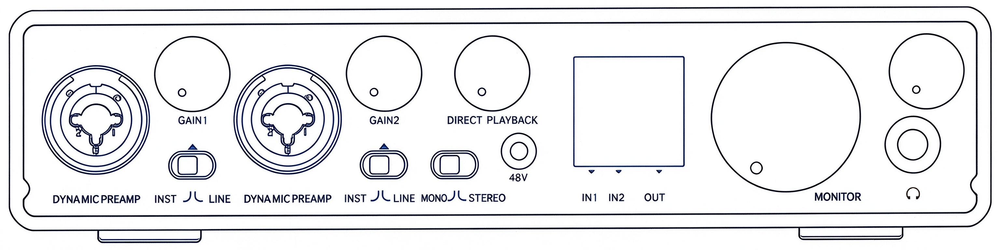
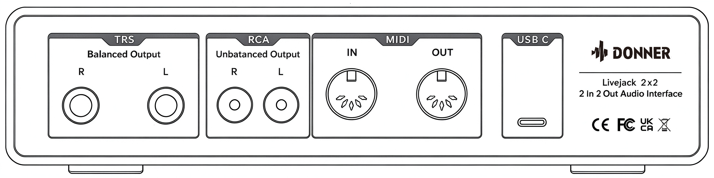

# Donner Livejack 中文控制面板

> 我手头只有 Livejack 2x2 这一个型号，所有测试均基于这台设备。

用中文调整声卡音量、采样率和缓冲；需要混合麦克风、电脑声音或给直播软件送音时，可以启用可选调音台。

适用于 **Windows 10/11 x64**，使用 Donner 原厂驱动，非 Donner 官方产品。

[下载最新版](https://github.com/topsai/donner-livejack-control-panel/releases/latest) · [反馈问题](https://github.com/topsai/donner-livejack-control-panel/issues) · 作者：[topsai (范斯特洛夫斯基)](https://github.com/topsai)

顺手给点个 Star。

## 先安装，再选择需要的功能

1. 在 [下载页](https://github.com/topsai/donner-livejack-control-panel/releases/latest) 选择 **名称带 `Setup` 的 EXE 安装包**。
2. 安装包自带原厂 Donner 驱动和运行环境。已有兼容驱动会跳过；缺少驱动时按向导安装，若要求重启，请先重启电脑。
3. 连接声卡，打开面板。顶部显示“已连接 Donner Livejack”后，就可以使用主页。

便携 ZIP 适合已经装好驱动的电脑：解压后保留整个文件夹，运行 `DonnerControlPanel.exe`。

### 卸载与清理

在 Windows **设置 → 应用 → 已安装的应用**中卸载“Donner 中文控制面板”。从 v1.40 起，卸载会退出后台面板、移除程序和快捷方式，并清理属于此安装位置的开机启动项。

卸载时会询问是否删除配置、预设、备份和日志：选择**是**清理 `%LOCALAPPDATA%\DonnerControlPanel`，选择**否**保留配置，方便重新安装。删除前请先导出需要的预设；正常覆盖升级不会清除配置。导出到其他位置的文件由你自己保管。

**原厂 Donner 驱动与 Voicemeeter Banana 是独立安装的软件**，卸载面板后仍可继续使用。如果也不再需要，请在 Windows 的应用列表中分别卸载；Banana 卸载后按提示重启，虚拟音频设备才会移除。不要直接删除驱动文件。

如果曾用面板修改 Windows 音频设备名称，希望还原时，请在卸载前进入**调音台 → 设备名称 → 恢复更名前名称**。删除面板数据会同时删除名称备份，卸载不会重置 Windows 默认音频设备或采样率。

已安装旧版的用户应先覆盖安装新版，再卸载，才能使用新的清理流程。便携 ZIP 没有卸载器：先退出面板、关闭开机启动，再删除解压目录；如需清除配置，可另行删除上述数据目录。

| 你想做什么 | 使用哪里 |
|---|---|
| 调声卡输入/输出音量、静音、采样率和缓冲 | 直接使用主页 |
| 查看声卡正面与背面面板图，以及正面接口和旋钮的说明 | 齿轮 → 面板说明 |
| 分开控制麦克风与电脑声音，再混合输出 | 启用调音台 |
| 给直播或语音软件发送混合后的声音 | 启用调音台，并使用 B1 或 B2 输出 |

### 开启调音台

进入 **齿轮 → 应用设置 → 启用调音台功能**。未安装 Voicemeeter Banana 时，按引导安装，并按其要求重启 Windows。Donner 安装包不附带 Banana。

安装引导会清理本次下载的临时文件；原厂安装向导运行期间会保留这些文件，完成或取消安装后再清理。

启用后，顶部出现“调音台”按钮，点击进入；按钮变为“主页”后，点击可返回声卡控制。Banana 会在后台处理声音，日常可以只操作这个中文面板。

> 如果你已经熟练使用 Banana，并有自己的配置，建议不要勾选。这里的设备选择、路由和音效会直接改变 Banana 配置；以后启动还会恢复本面板保存的设置，可能影响原来的使用方式。

## 第一次使用调音台：先把声音接通

先记住：**输入列决定声音从哪里来，A1 决定你从哪里听，B1 决定直播软件收到什么。**

### 1. 选择实际使用的音箱或耳机

进入 **输出与 EQ**，在 **A1 监听** 下选择实际连接音箱/耳机的输出，例如 `WDM · 扬声器（Livejack Audio Interface）`。

如果你原来已使用 `ASIO · Donner USB Audio Device`，也可在 A1 继续使用。ASIO 设备只支持放在 A1。

### 2. 接入麦克风

回到 **输入混音**，在 **输入 1** 下选择声卡的录音设备，例如 `WDM · 线路（Livejack Audio Interface）`。

“线路”是这台声卡在 Windows 中的设备名称，接在声卡上的麦克风也从这里进入。不要因名称里没有“麦克风”就改选 Realtek；Realtek 是电脑自己的另一套输入。

对麦克风说话，先确认这一列的电平条会跳动。若单声道麦克风只出现在一侧，可勾选这一列的“单声道”。

### 3. 接入电脑声音

在 Windows 或需要混入的播放软件中，将**输出设备**设为：

**`Voicemeeter Input` → 对应面板的“电脑声音 VAIO”这一列。**

播放声音，确认 VAIO 电平条跳动。若需要把另一款软件分开调节，可让它输出到 `Voicemeeter AUX Input`，声音就进入“电脑声音 AUX”。

### 4. 决定哪些声音送到哪里

在每个输入列下分别勾选：

| 勾选项 | 声音送往哪里 | 什么时候用 |
|---|---|---|
| **A1** | A1 选定的音箱或耳机 | 想自己听到这一列 |
| **A2** | 第二套输出设备 | 另接一套音箱或耳机时 |
| **A3** | 第三套输出设备 | 需要第三套输出时 |
| **B1** | 第一组虚拟混音输出 | 让直播/语音软件收到这一列 |
| **B2** | 第二组虚拟混音输出 | 给另一软件发送不同的混音 |

例如：麦克风与电脑声音两列都勾 **B1**，B1 就同时包含这两路声音。只想自己听电脑声音，就只给电脑声音列勾 **A1**。

### 5. 在直播或语音软件中选择混音

把该软件的**麦克风/音频输入**设为：

**`Voicemeeter Out B1`，简化名称后是“直播混音 1 (B1)”。**

此时软件收到的是所有勾选 B1 的声音。如果软件直接选择 Livejack 原始录音设备，收到的仍是声卡原始输入，不包含电脑声音和调音台里的处理。

若 B1 已包含电脑声音，请避免在同一个直播软件中重复采集这一路桌面声音，以免声音叠加。

B2 的用法相同，但选择 `Voicemeeter Out B2`。不需要第二组混音时，先不用 B2。

## 安装后多出来的音频设备，应该选哪个？

这些名称是软件里的“声音通道”，不会增加声卡上的物理接口。

**播放设备：把软件声音送进调音台。录音设备：让软件从调音台取出声音。** 名称里的 Input / Output 是从调音台的角度命名的。

### 日常先认这四个

| 原名称 | 简化后的名称 | 用途 |
|---|---|---|
| `Voicemeeter Input` | 电脑声音 → 调音台 (VAIO) | 在 Windows/播放软件的输出选项里选择；进入 VAIO 列 |
| `Voicemeeter AUX Input` | 伴奏 / 第二路声音 → 调音台 (AUX) | 在另一软件的输出选项里选择；进入 AUX 列，可单独控制 |
| `Voicemeeter Out B1` | 直播混音 1 (B1) | 在直播/语音软件的麦克风选项里选择；取出 B1 混音 |
| `Voicemeeter Out B2` | 直播混音 2 (B2) | 取出另一组 B2 混音；需要第二套内容时再使用 |

旧版的 `Voicemeeter Output` 对应 B1，`Voicemeeter AUX Output` 对应 B2。名称后面可能还有 `(VB-Audio …)`，不影响上述对应关系。

点击调音台右上角 **设备名称**，可以简化或自定义 Windows 中的名称，也能恢复原名。更名需要管理员授权；软件中仍显示旧名称时，重新打开该软件再选择。

<b>展开：逐一查看全部常见新增设备，包括 In 1–5、A1–A5 和 VAIO3</b>

下面列出新版驱动可能安装的 8 个播放设备和 8 个录音设备。**看到名称不代表当前 Banana 版本和授权已支持它。**

#### Windows 播放设备：软件往这里送声音

| 名称 | 对应通道/用途 | 普通 Banana 用户如何选择 |
|---|---|---|
| `Voicemeeter Input` | 电脑声音 VAIO | 常用，接收第一路软件声音 |
| `Voicemeeter AUX Input` | 电脑声音 AUX | 常用，接收第二路软件声音 |
| `Voicemeeter VAIO3 Input` | Potato 的第三路虚拟输入 | Banana 不使用，先跳过 |
| `Voicemeeter In 1` | VAIO 扩展：将软件声音接入输入条 1 | 需要相应 VAIO 扩展授权和配置；新手先跳过 |
| `Voicemeeter In 2` | VAIO 扩展：将软件声音接入输入条 2 | 同上，不是第二个麦克风接口 |
| `Voicemeeter In 3` | VAIO 扩展：将软件声音接入输入条 3 | 同上，不是第三个麦克风接口 |
| `Voicemeeter In 4` | 更大版本的 VAIO 扩展输入 4 | Banana 没有对应输入条，先跳过 |
| `Voicemeeter In 5` | 更大版本的 VAIO 扩展输入 5 | Banana 没有对应输入条，先跳过 |

#### Windows 录音设备：软件从这里接收声音

| 名称 | 对应通道/用途 | 普通 Banana 用户如何选择 |
|---|---|---|
| `Voicemeeter Out B1` | B1 混音 | 常用，作为直播/语音软件的麦克风输入 |
| `Voicemeeter Out B2` | B2 混音 | 第二组独立混音，需要时再选 |
| `Voicemeeter Out B3` | Potato 的第三组虚拟混音 | Banana 不使用，先跳过 |
| `Voicemeeter Out A1` | VAIO 扩展：给软件读取 A1 总线声音 | 可用性取决于扩展授权和配置；初次使用选 B1 更直接 |
| `Voicemeeter Out A2` | VAIO 扩展：给软件读取 A2 总线声音 | 同上；不是让耳机发声的设备选择 |
| `Voicemeeter Out A3` | VAIO 扩展：给软件读取 A3 总线声音 | 同上；不是让第三套音箱发声的设备选择 |
| `Voicemeeter Out A4` | 更大版本的扩展总线 A4 | Banana 没有 A4 总线，先跳过 |
| `Voicemeeter Out A5` | 更大版本的扩展总线 A5 | Banana 没有 A5 总线，先跳过 |

**面板里勾选 A1 监听，不需要额外购买 VAIO 扩展。** 它把声音送到你选定的真实音箱/耳机；上表的 `Voicemeeter Out A1` 是另一条给软件读取声音的扩展通路。

以上映射与扩展授权条件参照 [VB-Audio 的设备说明](https://voicemeeter.com/quick-tips-voicemeeter-virtual-inputs-and-outputs-windows-10-and-up/)和 [Banana 官方手册的 VAIO Extension 部分](https://vb-audio.com/Voicemeeter/VoicemeeterBanana_UserManual.pdf)。本面板不提供 VAIO 扩展激活功能。

### 为什么同一台声卡有 WDM、MME、KS、ASIO？

它们是软件访问设备的不同方式，不是多出几台声卡。在本面板里选择时，可先用 **WDM**；MME 可用于兼容性排查，KS、ASIO 留给有明确需要的连接方式。ASIO 仅能选在 A1。

## 调音台按钮怎么用？

### 顶部与页面切换

| 按钮/显示 | 做什么 |
|---|---|
| **调音台 / 主页** | 在声卡主页与调音台之间切换 |
| **重连** | 重新检测并连接 Donner 声卡 |
| **齿轮** | 打开配置预设、应用设置、面板说明、关于等页面 |
| **采样率设置** | 查看或修改 Windows 录音、Windows 播放、Banana 首选、Donner 实际采样率 |
| **打开原界面** | 显示 Banana 自己的界面，需要高级功能时使用 |
| **后台运行** | 隐藏 Banana 原界面，音频处理继续运行 |
| **设备名称** | 给 Windows 中的音频设备改名，查看用途或恢复原名 |
| **刷新设备** | 更新调音台的设备列表，插拔设备后可用 |
| **重启引擎** | 让 Banana 重新打开音频设备，声音会短暂中断；不会清空配置 |
| **输入混音** | 选择声源，调节各路声音，并选择 A1–A3 / B1–B2 去向 |
| **输出与 EQ** | 选择音箱/耳机，调节整组混音的音量和输出 EQ |

### 每一列的控件

| 控件 | 做什么 | 初次使用 |
|---|---|---|
| 设备下拉框 | 输入列选择麦克风等声源；A1–A3 选择真实输出 | 先接通输入 1 和 A1，其余按需使用 |
| 竖向推子 / 下方 dB 数字 | 调整这一列的声音大小；数字可直接输入 | `0 dB` 表示不增不减；双击推子或输入 `0` 可归零 |
| 彩色电平条 | 看有没有信号、声音是否太强 | 它随声音跳动，不是音量旋钮；先用较小音量监听 |
| 静音 | 暂停这一列的声音 | 再点一次取消静音 |
| 单声道 | 将左右声道合成单声道 | 单声道麦克风偏在一侧时可使用；立体声电脑声音通常保留原样 |
| A1 / A2 / A3 | 将这一列送到指定音箱/耳机 | 自己要听哪一路，就给那一路勾对应 A 项 |
| B1 / B2 | 将这一列送到指定虚拟混音 | 软件要收到哪一路，就给那一路勾对应 B 项 |
| 输入 1 / 2 / 3 EQ | 切换要编辑的麦克风/硬件输入 EQ | 选中蓝色只表示正在编辑；绿点才表示 EQ 已启用 |
| A1 / A2 / A3 / B1 / B2 EQ | 切换要编辑的输出 EQ | 改 A1 影响自己听到的混音；改 B1 影响送给软件的混音 |
| 压缩 | 缩小大声和小声的差距，让音量更平稳 | 先保持 `0`，接通声音后再少量增加 |
| 噪声门 | 小于一定强度时压低声音，减少停顿时的底噪 | 先保持 `0`；过大会吞掉轻声或句首 |
| 低频 / 中频 / 高频 | 调整 VAIO、AUX 的三段音色 | `0` 为不增不减 |

推子范围是 **−60 至 +12 dB**：负值变小，正值放大；正值过高可能失真。主页的百分比音量与调音台的 dB 增益是两套不同控制。

### EQ 编辑区

| 控件/颜色 | 含义 |
|---|---|
| **启用输入 N EQ / 启用 A1 等输出 EQ** | 开关当前目标的均衡处理 |
| **频段 1…10 / 1…6** | 选择要修改的频段；输入有 10 段，输出有 6 段 |
| **启用频段** | 单独开关这一段，不影响其他段 |
| **频率 Hz** | 改声音的哪个频率位置；左右拖动节点也可调整 |
| **增益 dB** | 该频段提升或衰减多少；上下拖动节点也可调整 |
| **Q** | 控制宽窄或共振；滚轮也能调节，不同滤波类型作用不同 |
| **左 / 右、左右联动** | 输出 EQ 可编辑单侧，或将本次修改同时写入两侧 |
| **输出增益** | 输入 EQ 处理后的整体音量 |
| **恢复平直** | 清除当前目标的 EQ 曲线调整；不要当成撤销按钮使用 |
| **黄色曲线** | EQ 频率响应；输出页为滤波器模型示意 |
| **灰色起伏** | 当前目标的实时频谱 |

钟形用于调整某段音色；低切削减低频，高切削减高频；低架/高架整体调整低频/高频，陷波削减很窄的一段，带通保留某一段。先接通声音，再按听感少量调整。详细参数说明见 [调音台进阶说明](docs/mixer.md)。

## 没有声音时，按这个顺序检查

| 现象 | 先检查 |
|---|---|
| 声卡屏幕有麦克风电平，调音台输入列没有 | 是否选对 Livejack 录音设备；检查采样率，再点击“重启引擎” |
| 调音台有电平，音箱/耳机没声 | 该输入是否勾 A1；A1 是否选对真实输出；输入与 A1 是否静音 |
| 电脑声音没有进入 VAIO | Windows/播放软件的输出是否选了 `Voicemeeter Input` |
| 自己能听到，直播软件没声 | 相关输入是否勾 B1；软件麦克风是否选了 `Voicemeeter Out B1` |
| 直播软件有麦克风，但没有电脑声音 | 给“电脑声音 VAIO/AUX”勾 B1，并确认直播软件使用 B1 |
| 有回声、声音重复或啸叫 | 检查是否重复采集同一路声音、Windows 是否开启“侦听此设备”、声卡直通是否与软件监听叠加；麦克风靠近音箱时改用耳机 |
| 重开软件后又没声 | 检查是否载入了旧预设中的设备或采样率，修正后重新保存预设 |

**采样率排查：** 本机曾出现 Windows 录音为 88.2 kHz、声卡实际为 48 kHz 时，Livejack 麦克风无声；统一到 48 kHz 并重启引擎后恢复。遇到类似问题，可在“采样率设置”核对四项，以设备支持的同一个值设置，例如 48 kHz；修改 Banana 首选后需要重启引擎。设置本身可能需要管理员授权，硬件正被其他音频软件占用时请先释放设备。

## 保存与下次继续使用

配置会自动保存，关闭程序和升级后继续使用上次设置。输入 EQ 需要本面板保持运行；关闭面板期间不再处理麦克风 EQ。Banana 本身可能仍在后台运行，取消“启用调音台”也不会强行结束它。

想保存不同用途的配置，进入 **齿轮 → 配置预设**：

- **保存预设**：输入名称，保存当前设备、调音台、EQ 和应用设置；同名保存会覆盖该预设。
- **应用所选预设**：先选左侧列表，检查右侧内容，再应用。它会改变当前设备和混音设置。
- **导出 / 导入预设**：用 JSON 文件备份或迁移；同名导入会另存。

设备暂未连接时保留其设置，连接后再恢复；不同设备或未支持的设置仍受检查。数据保存在 `%LOCALAPPDATA%\DonnerControlPanel`，卸载面板保留驱动与个人配置。

## 更多说明

LiveJack 2X2 正面与背面面板图由用户 **MAX2078** 提供。

- [调音台进阶说明](docs/mixer.md)：采样率、EQ、设备名称与使用边界。
- [原厂驱动功能](docs/driver-features.md)：格式、安全模式和流模式等设置。
- [开发、构建与验证](docs/development.md)：源码构建、驱动打包与回归检查。
- [Banana 官网](https://vb-audio.com/Voicemeeter/banana.htm)：独立产品，采用 Donationware 授权；可选功能与专业用途请查看其原厂条款。

## 目前无法实现的硬件状态显示

目前无法可靠读取并显示以下前面板实体控制的位置或状态，因此应用不显示这些状态：

- 旋钮：GAIN1、GAIN2、DIRECT PLAYBACK、MONITOR、耳机音量。
- 开关：输入 1 和输入 2 的 INST/LINE、MONO/STEREO、48V 幻象电源。

2026-10-15 在本人持有的 Livejack 2x2 上进行了只读实机测试。用户操作旋钮和开关期间，两轮共读取 975 份 HID 输入报告，全部为 `0000`；输入、输出总通道及左右通道的数字音量、静音和设备属性均未变化。48V 没有找到可识别的状态字段，且其切换动作未单独确认，因此不计为已完成切换验证。

软件中的通道音量和静音属于驱动数字控制，不能代表实体旋钮和开关的位置；`0000` 也不表示面板所有开关都关闭。本次已测试的原厂 API、USB 描述符和 HID 接口未提供可用于可靠显示这些状态的信息。此结论仅限当前设备与已测试接口，不代表已经证明硬件永久不支持或不存在其他私有协议。
