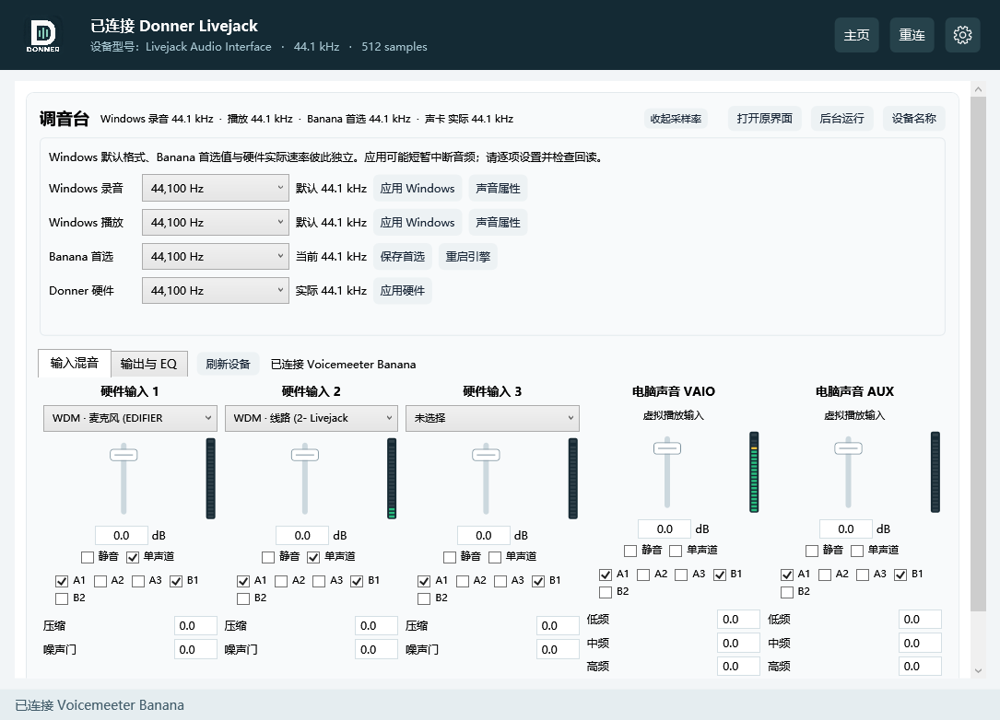

# 可选调音台

调音台通过 VB-Audio 官方 Voicemeeter Remote API 控制 Voicemeeter Banana。原厂声卡控制保持独立；Banana 未启用时不会加载其 DLL、启动程序或下载组件。

> 本功能面向不熟悉 Banana 等专业调音软件的用户。已经安装并熟练使用 Banana 的用户建议不要勾选：选择设备、调整路由或音效会直接改动 Banana 的现有配置，可能影响您原来的使用方式。连接时不重置参数，不代表后续操作不会改变配置。

## 开启与安装

1. 打开右上角齿轮 → 应用设置 → 勾选“启用调音台功能”。默认不勾选。
2. 未安装 Banana 时显示安装引导。点击“下载并安装 Banana”才会从 VB-Audio 官方网站下载安装包，验证有效的原厂 Authenticode 签名后运行交互安装程序。
3. 按原厂安装向导操作。虚拟驱动需要管理员授权，安装后需要重启 Windows；本面板不会主动重启电脑。
4. 安装后重新打开 Donner 面板；如尚未连接，在应用设置中点击“重连调音台”。顶部“重连”前出现“调音台”按钮，点击进入独立页面；按钮变为“主页”，再次点击返回原声卡控制页。输入混音、输出与 EQ 均在调音台页面，主页保持原有声卡控制布局。
5. 取消安装引导不会启用功能。取消勾选会隐藏调音台入口，若正在调音台页面则返回主页；同时释放本面板的 API 连接并取消自动启动；不会强制退出已经运行的 Banana。完全停止混音时，请另外退出 Banana。

统一安装包不附带 Banana；原厂 Donner 驱动仍按原有安装流程提供。Banana 安装、升级和卸载由其原厂程序负责。

### 后台使用与设备名称（v1.25）

启用调音台后，Donner 面板自动连接或在后台启动 Banana，并隐藏原界面；只使用本面板即可调节现有混音功能。Banana 音频引擎仍须运行。调音台中的“打开原界面”用于需要高级设置时主动显示它，“后台运行”重新隐藏原界面。引擎退出后，启用期间会尝试后台重启；取消勾选则停止自动启动，不会强制结束仍在使用的混音引擎。

齿轮 → 应用设置 → **设备名称与用途** 可查看对应关系，并按需点击“简化 Windows 设备名称”或“恢复更名前名称”。更名需要 Windows 管理员授权。更名前保存备份，恢复时跳过后来手动设置的名称；不修改设备 ID、默认音频设备或混音路由，也不禁用任何设备。Windows 与使用这些设备名称的直播软件可显示中文；已经打开的软件可能需要重新启动，ASIO/KS 等直接使用驱动名称的界面可能仍显示原名。

| Windows 中的用途 | 中文名称 | 原厂名称 |
|---|---|---|
| 播放设备：电脑声音送入调音台 | 电脑声音 → 调音台 (VAIO) | Voicemeeter Input |
| 播放设备：伴奏等第二路声音送入调音台 | 伴奏 / 第二路声音 → 调音台 (AUX) | Voicemeeter AUX Input |
| 录音设备：直播软件读取第一路混音 | 直播混音 1 (B1) | Voicemeeter Out B1 / Output |
| 录音设备：直播软件读取第二路混音 | 直播混音 2 (B2) | Voicemeeter Out B2 / AUX Output |

A1–A3 的录音端点标为“监听总线录音”；额外播放通道标为“扩展播放通道”。VAIO3、A4、A5、B3 标明 Potato 扩展，不将它们当作 Banana 可用条带。这些额外设备来自原厂驱动，本项目不会自动删除。

更名备份位于 `%LOCALAPPDATA%\DonnerControlPanel\mixer-endpoint-names.json`，请保留，以便恢复。更新或重装 Banana 驱动可能重建设备，需要重新核对名称。

### 采样率、自定义名称与主页电平

调音台顶部直接显示 Windows 录音、Windows 播放、Banana 首选和 Donner 实际采样率。点击标题旁的“采样率设置”可展开编辑区并逐项修改：

- Windows 两项：修改 Livejack 录音/播放端点的默认格式，需要管理员授权，成功时检查 Windows 音频引擎的回读。
- Banana 首选：点击“保存首选”，再按需点击“重启引擎”；首选值与声卡实际工作速率分开展示。
- Donner 硬件：通过原厂 API 设置，使用驱动报告的支持列表，显示实际回读。被其他音频程序占用或未生效时报告失败。

这些值不一定必须相同，但在本机卡拉 OK 连接方式下建议保持一致。改动可能短暂中断声音；采样率区加载和刷新只读取，不自动提交选择值。

点击调音台右上角“设备名称”（或齿轮 → 应用设置 → 设备名称与用途），可编辑当前物理和虚拟播放/录音设备的名称，再点击“保存自定义名称”。名称同时用于 Windows 和本面板，保留设备 ID，原名备份可恢复。其他软件若仍使用旧名称，需要重新选择设备或重启刷新。

Banana 接管 Livejack 输出时，主页从实际对应的 A1/A2/A3 总线读取左右声道电平，避免独占输出使 Windows 回环采集失效。不会将其他声卡的总线或某一通道的最大值冒充左右输出。未能唯一对应总线时不显示错误的替代读数；关闭调音台后恢复原来的 Windows 采集方式。电平不包含声卡的模拟直通监听。

## 面板功能

- 输入混音：三个硬件输入条、VAIO 和 AUX 两个虚拟输入条，支持增益、电平、静音、单声道及 A1/A2/A3/B1/B2 路由。
- 硬件输入条支持选择音频设备、压缩和噪声门；虚拟输入支持低、中、高三段音色调节。
- 输出与 EQ：五个总线的增益、电平和静音；A1/A2/A3 可选择物理输出设备，ASIO 设备仅用于 A1。
- 总线六段 EQ：频段开关、频率、增益、Q，以及所选左/右声道或左右联动。保留 Banana 原有滤波类型；如需改变滤波类型，可打开 Banana 的 EQ 界面。
- 读取 Banana 当前参数，不会在第一次连接时重置路由、设备选择、推子或 EQ。后台刷新复用控件，输入数值和拖动时保留操作；异步写入短暂保留目标值，超时后显示实际回读值。
- 连接中断后禁止写入；Banana 恢复运行后重新读取参数。启用期间会尝试在后台重启退出的引擎。需要高级设置时点击“打开原界面”，返回后台时点击“后台运行”。

“三个硬件输入条”是 Banana 的软件条带，不会增加 Livejack 2x2 的物理接口。

调音台推子的 **-60 至 +12 dB** 是 Banana 的增益范围：0 dB 不增不减，负值衰减，正值放大。拖动靠近零点会吸附；**下方分贝数值支持直接输入（-60 至 +12 dB，一位小数），按 Enter 或离开输入框应用；输入 0 或双击推子可精确归零**，方向键保持 0.1 dB 微调。归零只修改该通道的增益，不切换静音和路由。

## 麦克风＋伴奏直播

1. 在硬件输入条中选择 Livejack 的麦克风输入；A1 选择用于监听的声卡输出。
2. 将伴奏软件输出设备设为 Voicemeeter Input 或 AUX Input。
3. 将麦克风和伴奏所在条带的 B1 路由打开；需要耳机监听时打开对应 A1。
4. 在直播软件中选择 B1 对应的 Voicemeeter 虚拟录音设备。不同版本的端点名称可能是 Voicemeeter Out B1 或 Voicemeeter Output。
5. 直播软件直接选择 Donner 原始麦克风时，会绕过 Banana 的混音处理。避免把直播返回声再次送入同一直播总线，以免形成回声环路。

本版不提供录音功能或 VST 插件宿主。原厂 ASIO 缓冲、采样率与 Banana 的音频引擎设置仍需协调；实际延迟与设备占用取决于所用驱动和路由。

## 授权与验证范围

Banana 为 VB-Audio 的独立 Donationware 产品，并非本项目的开源组成部分。可先安装评估，专业或机构用途按原厂授权条款处理：

- 官网：https://vb-audio.com/Voicemeeter/banana.htm
- 授权：https://vb-audio.com/Services/licensing.htm
- Remote API SDK：https://github.com/vburel2018/Voicemeeter-SDK

本次完成 70 项核心检查、模拟 API 后端的界面交互回归、原厂安装包签名正向验证和未签名文件拒绝验证。v1.24 另验证了默认隐藏入口、独立页面切换、返回主页保留控件和停用后返回主页，并已连接本机正在运行的 Banana，只读读取参数及采集上述截图，参数写入尝试为 0。未验证真实 Banana 引擎与 Livejack 的直播音频链路；不能把界面与读取验证当作实际音质、延迟或兼容性保证。

v1.25 实机验证：后台启动后 Remote API 保持连接，等待界面命令完成后可见窗口为 0；16 个 Windows 音频设备完成“简化 → 恢复 → 再次简化”回读检查。界面测试另覆盖原界面/后台操作分离、损坏名称备份不崩溃且保留原文件。上述操作未调节音频增益、EQ、路由或默认设备。

v1.27 实机检查：Windows 录音与播放端点分别完成 44.1 → 48 → 44.1 kHz 的引擎格式回读；两个 Livejack 端点完成自定义名称与恢复检查，ID 不变。检查后恢复原名与 44.1 kHz。主页输出确认读取 Livejack 对应 Banana 总线的左右声道，未请求 WASAPI 输出回环。另有 41 项名称/请求/报告保护检查及采样率区延迟回读回归。更改 Windows 格式使用系统音频策略接口，失败时明确提示并提供 Windows 声音属性入口。

v1.28：采样率摘要和设置入口上移至标题旁。Windows 设备/采样率查询与 WASAPI 生命周期均在后台执行，单类只保留一个在途查询，隐藏页面不继续触发刷新。慢读取、查询重叠、过期缓存、停止后异步清理、旧任务等待屏障均有回归检查。真实约1.88秒查询期间界面调度最大间隔约32ms，见 [本机记录](verification/v1.28-responsiveness.json)。这轮只读检查未修改当前音频配置。
